# 🌿 AquaVerde

**Prototipo de inicio de sesión y registro para Android · Java + XML · Material Design 3**

<p align="center">
  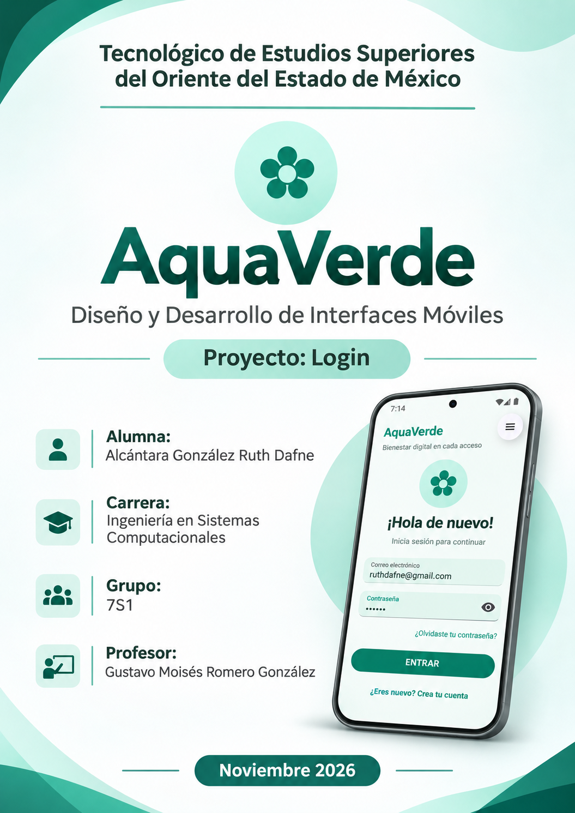
</p>

<p align="center">
  <strong>Bienestar digital en cada acceso</strong><br>
  Una experiencia móvil limpia, accesible y adaptable a los modos claro y oscuro.
</p>

> [!IMPORTANT]
> **Proyecto académico y demostrativo.** AquaVerde valida los datos introducidos y muestra respuestas en pantalla, pero **no autentica contra un servidor, no registra cuentas en una base de datos y no envía correos de recuperación**. Los mensajes de éxito son simulados.

## 📌 Contenido

- [Descripción](#-descripción)
- [Características](#-características)
- [Diseño de interfaz](#-diseño-de-interfaz)
- [Capturas de pantalla](#-capturas-de-pantalla)
- [Tecnologías](#-tecnologías)
- [Estructura del proyecto](#-estructura-del-proyecto)
- [Instalación y ejecución](#-instalación-y-ejecución)
- [Validaciones y pruebas](#-validaciones-y-pruebas)
- [Alcance y mejoras futuras](#-alcance-y-mejoras-futuras)
- [Información académica](#-información-académica)

## 💚 Descripción

**AquaVerde** es una aplicación de demostración para Android que presenta un flujo de acceso y registro de usuarios. El objetivo es aplicar buenas prácticas de diseño de interfaces móviles, componentes Material Design 3, navegación entre pantallas, formularios claros y validación inmediata de datos.

Su identidad visual utiliza tonos **verde esmeralda, aqua y menta**, un emblema floral, campos de texto con fondo suave y botones de esquinas redondeadas. A diferencia de una interfaz basada en tarjetas, AquaVerde distribuye los elementos directamente sobre un fondo amplio y luminoso.

## ✨ Características

| Módulo | Funcionalidad |
|:--|:--|
| 🔑 **Inicio de sesión** | Captura de correo y contraseña; valida formato del correo y longitud mínima de seis caracteres. |
| 👤 **Registro** | Solicita nombre completo, correo, contraseña y confirmación; detecta errores e inconsistencias. |
| ✉️ **Recuperación** | Abre un diálogo para escribir y validar el correo; muestra una confirmación simulada. |
| 👁️ **Contraseñas** | Permite mostrar u ocultar la contraseña mediante el icono del campo. |
| 🌓 **Apariencia** | Incluye recursos de color para modo claro y oscuro y soporte de colores dinámicos en dispositivos compatibles. |
| ✅ **Retroalimentación** | Señala campos inválidos mediante mensajes de error y muestra avisos de éxito de demostración. |
| 📱 **Navegación** | Permite ir del login al registro y regresar sin complicaciones. |

## 🎨 Diseño de interfaz

El desarrollo visual se documentó en tres etapas: **boceto**, **wireframe** y **mockup**. Estas láminas son materiales de diseño; las capturas de la sección siguiente corresponden a la aplicación funcionando en Android.

### 1. Boceto inicial — baja fidelidad

El boceto explora la posición del encabezado, el emblema floral, los campos y las acciones principales. Incluye una propuesta para el formulario de registro y el diálogo de recuperación.

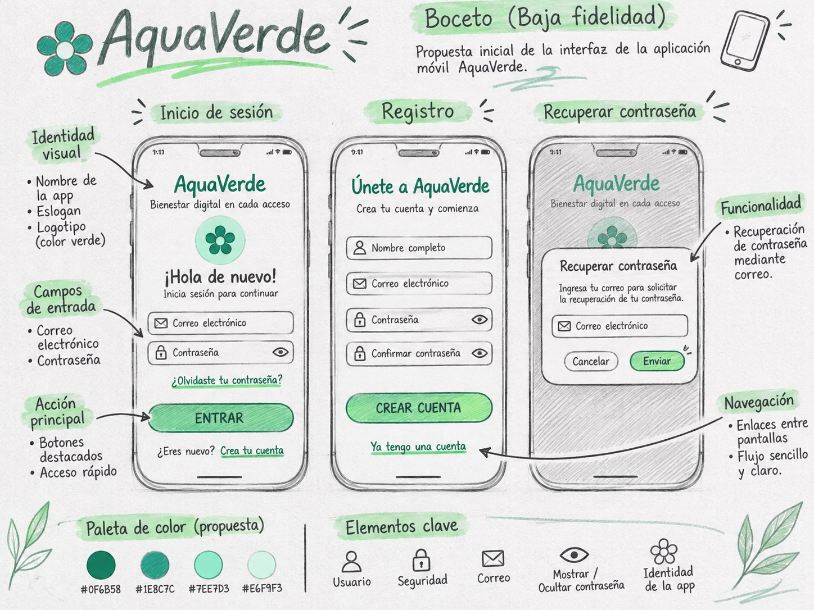

### 2. Wireframes — estructura

Los wireframes representan la jerarquía visual en escala de grises y permiten revisar la distribución de elementos sin depender todavía de los colores definitivos.

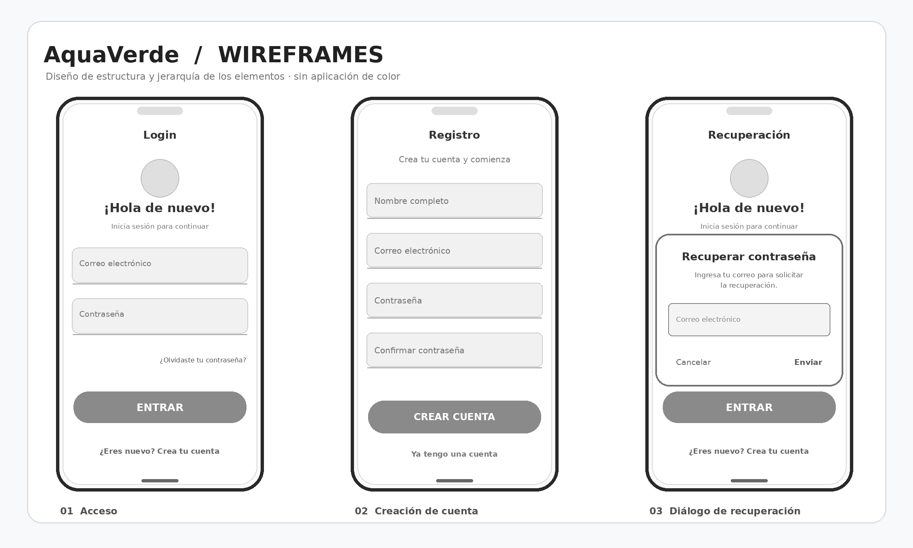

### 3. Mockups — alta fidelidad

Los mockups muestran la propuesta visual con tipografía, colores, botones, campos, estados de error y variantes de la interfaz.

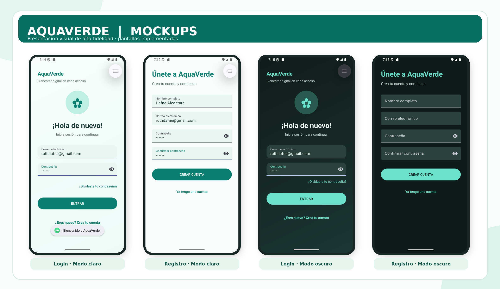

## 📸 Capturas de pantalla

Las imágenes siguientes son **evidencias reales del prototipo**. Se obtuvieron de la ejecución de AquaVerde en un emulador Android.

### Registro en modo claro y validación de datos

<table>
  <tr>
    <td align="center">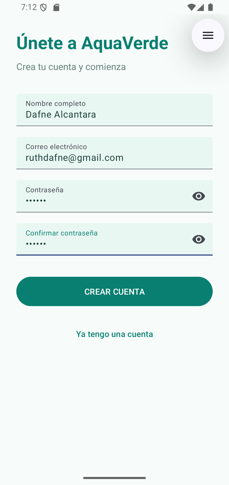<br><b>Registro (modo claro)</b></td>
    <td align="center">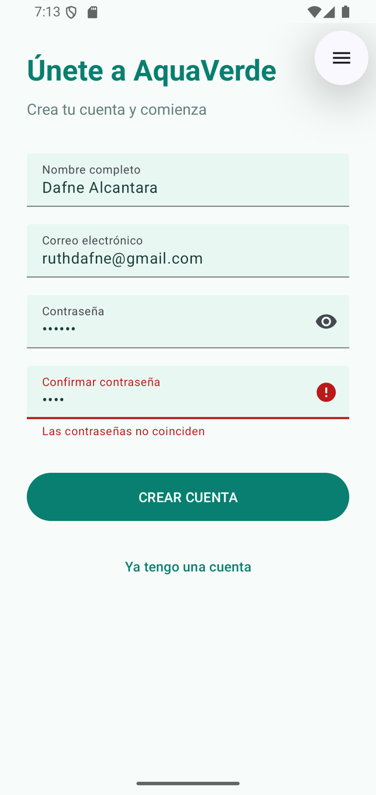<br><b>Validación: contraseñas no coinciden</b></td>
  </tr>
</table>

### Inicio de sesión y recuperación de contraseña

<table>
  <tr>
    <td align="center">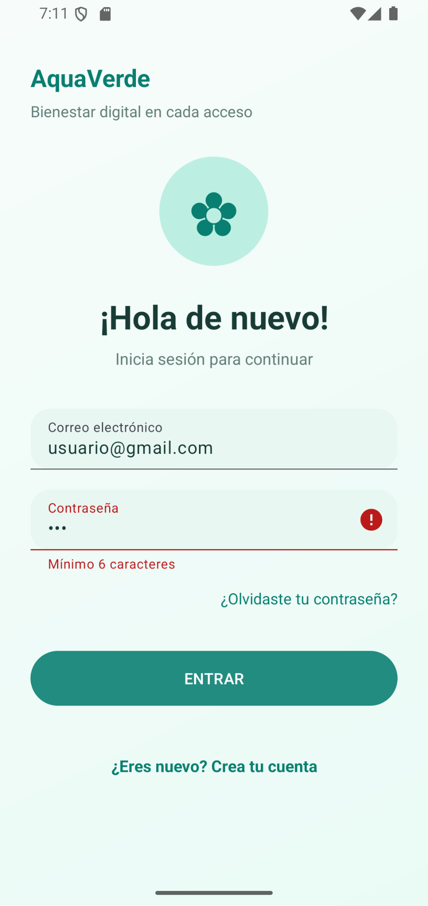<br><b>Error: contraseña corta</b></td>
    <td align="center">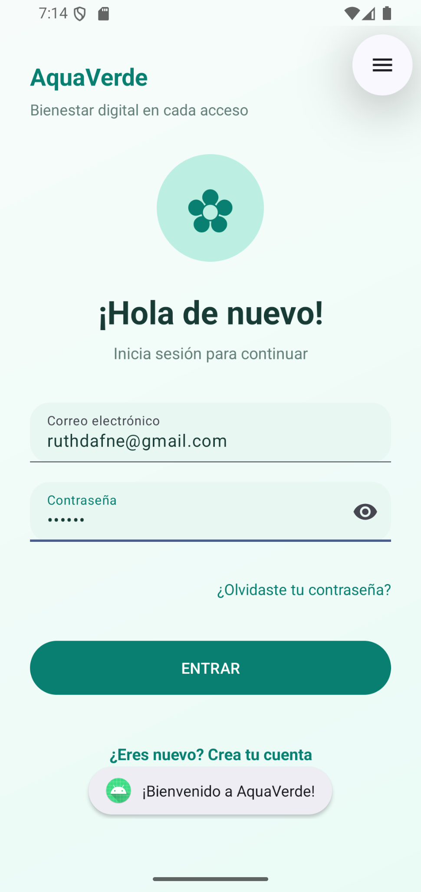<br><b>Mensaje de bienvenida</b></td>
    <td align="center">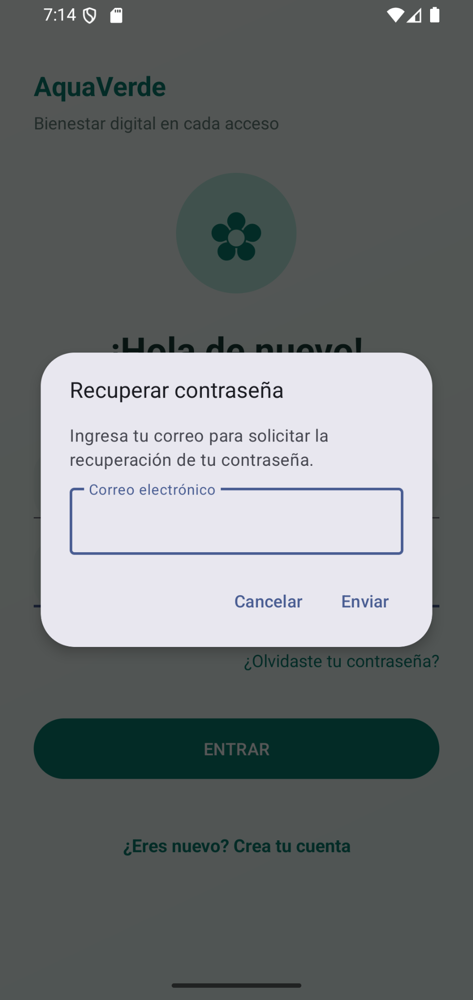<br><b>Recuperación simulada</b></td>
  </tr>
</table>

### Modo oscuro

<table>
  <tr>
    <td align="center">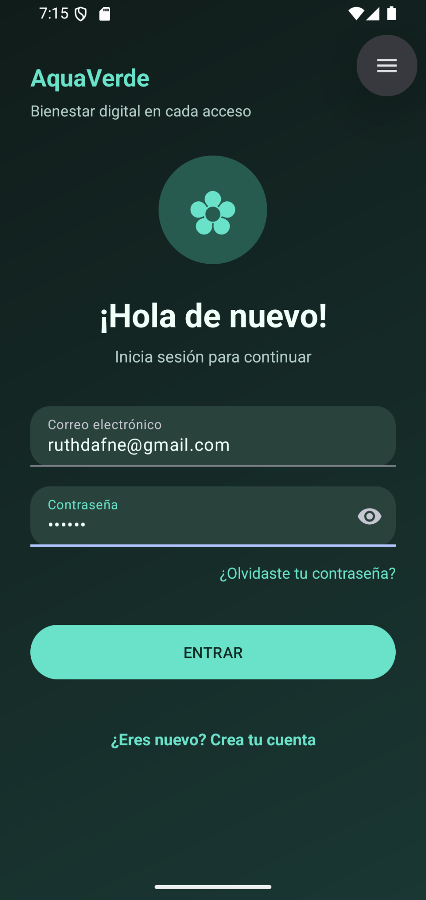<br><b>Login oscuro</b></td>
    <td align="center">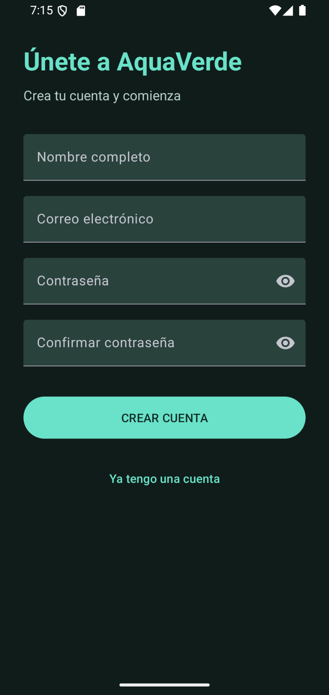<br><b>Registro oscuro</b></td>
  </tr>
</table>

## 🛠️ Tecnologías

- **Android Studio:** entorno de desarrollo.
- **Java:** lógica de eventos, navegación y validaciones.
- **XML:** diseño declarativo de las pantallas y recursos.
- **Material Design 3 / Material Components:** `TextInputLayout`, `TextInputEditText`, `MaterialButton`, `MaterialAlertDialogBuilder`.
- **Gradle (Kotlin DSL):** configuración y compilación del proyecto.
- **AndroidX AppCompat:** compatibilidad y ciclo de vida de las Activities.

### Colores y estilo

| Elemento | Diseño |
|:--|:--|
| Principal | Verde esmeralda |
| Secundario | Aqua / menta |
| Campos | Superficies suaves con contraste legible |
| Botones | Grandes y totalmente redondeados |
| Tema | Material 3 con recursos `values` y `values-night` |

## 🗂️ Estructura del proyecto

```text
AquaVerde/
├── app/
│   └── src/main/
│       ├── AndroidManifest.xml
│       ├── java/com/cg128/aquaverde/
│       │   ├── MainActivity.java
│       │   └── ui/
│       │       ├── LoginActivity.java
│       │       └── RegistroActivity.java
│       └── res/
│           ├── layout/
│           │   ├── activity_login.xml
│           │   └── activity_registro.xml
│           ├── drawable/
│           │   ├── bg_login_aqua.xml
│           │   ├── bg_campo_aqua.xml
│           │   └── bg_logo_aqua.xml
│           ├── values/
│           │   ├── colors.xml
│           │   └── themes.xml
│           └── values-night/
│               ├── colors.xml
│               └── themes.xml
├── docs/
│   └── imagenes/                   # Bocetos, wireframes, mockups y capturas
├── gradle/
├── build.gradle.kts
├── settings.gradle.kts
└── README.md
```

`LoginActivity` es la pantalla de inicio configurada en el `AndroidManifest.xml`. `RegistroActivity` gestiona el formulario de alta; `MainActivity` es la Activity base creada originalmente con el proyecto y no representa el punto de entrada principal.

## 🚀 Instalación y ejecución

**Requisitos:** Android Studio, SDK de Android instalado y un emulador o teléfono Android compatible con la configuración del proyecto.

1. Clona este repositorio:

   ```bash
   git clone https://github.com/DafneALG/AquaVerde.git
   ```

2. Abre **Android Studio → Open** y selecciona la carpeta `AquaVerde`.
3. Espera a que finalice la sincronización de Gradle. Si Android Studio solicita instalar componentes del SDK, acepta la instalación.
4. Selecciona un emulador o dispositivo físico. El proyecto se probó con un emulador **Pixel 4**.
5. Ejecuta el módulo **app** con el botón **Run ▶**.
6. Desde el login, prueba los enlaces de registro y recuperación, las validaciones y el cambio entre los modos claro y oscuro desde Android.

## 🧪 Validaciones y pruebas

| Escenario | Comportamiento esperado |
|:--|:--|
| Correo vacío | Se solicita ingresar el correo. |
| Correo con formato incorrecto | Aparece un mensaje de correo inválido. |
| Contraseña vacía o menor a seis caracteres | Aparece el error correspondiente. |
| Login con formato de datos válido | Se muestra un mensaje de bienvenida **simulado**. |
| Registro sin nombre o correo válido | Se muestran mensajes de error en los campos. |
| Contraseñas diferentes | Se indica que las contraseñas no coinciden. |
| Registro con campos válidos | Se muestra una confirmación **simulada** y se regresa al login. |
| Recuperación con correo inválido | El diálogo solicita un correo válido. |
| Recuperación con correo válido | Se muestra un aviso **simulado**, sin enviar ningún correo real. |
| Modo oscuro | La interfaz utiliza la paleta oscura definida en los recursos. |

Las capturas incluidas documentan varias de estas pruebas. Los demás casos describen las validaciones programadas en el prototipo; no equivalen a pruebas automatizadas ni de un servidor real.

## 🔎 Alcance y mejoras futuras

AquaVerde está diseñado para demostrar la **experiencia de usuario** y la interacción de pantallas. Para convertirlo en un sistema de autenticación real sería necesario implementar un backend seguro, almacenamiento de usuarios, políticas de contraseñas, gestión de sesiones y recuperación de cuenta por un canal verificado.

Otras mejoras propuestas son realizar pruebas con usuarios, comprobar la accesibilidad con tamaños de fuente mayores y adaptar la distribución a más resoluciones y orientaciones de pantalla.

## 🎓 Información académica

| Dato | Información |
|:--|:--|
| **Institución** | Tecnológico de Estudios Superiores del Oriente del Estado de México (TESOEM) |
| **Carrera** | Ingeniería en Sistemas Computacionales |
| **Materia** | Diseño y Desarrollo de Interfaces Móviles |
| **Proyecto** | Login y registro de usuarios — AquaVerde |
| **Alumna** | **Alcántara González Ruth Dafne** |
| **Grupo** | 7S1 |
| **Profesor** | Gustavo Moisés Romero González |
| **Fecha** | Noviembre de 2026 |

**Repositorio:** [DafneALG/AquaVerde](https://github.com/DafneALG/AquaVerde)

## 📚 Referencias de consulta

- [Material Design 3](https://m3.material.io/)
- [Android Developers — Recursos alternativos](https://developer.android.com/guide/topics/resources/providing-resources)
- [Android Developers — Colores dinámicos](https://developer.android.com/develop/ui/views/theming/dynamic-colors)

---

<p align="center"><strong>🌿 AquaVerde — Bienestar digital en cada acceso</strong></p>
